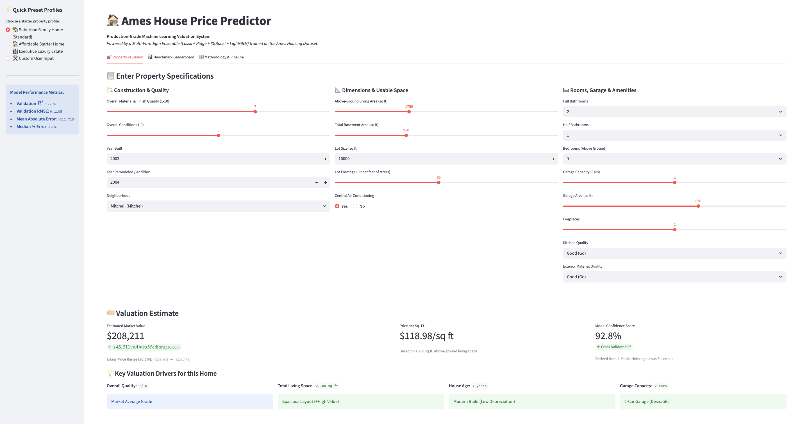
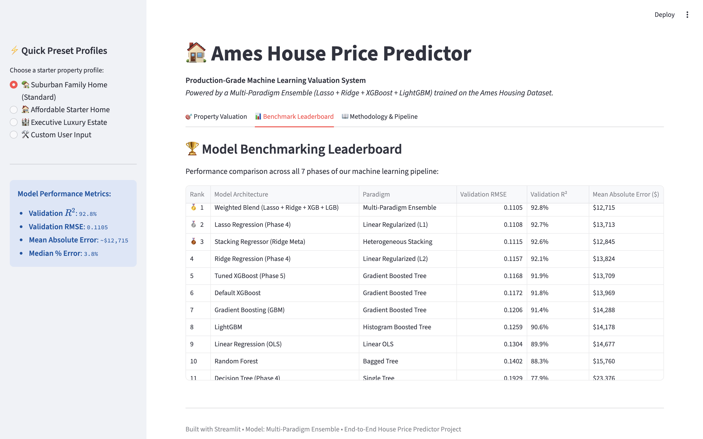
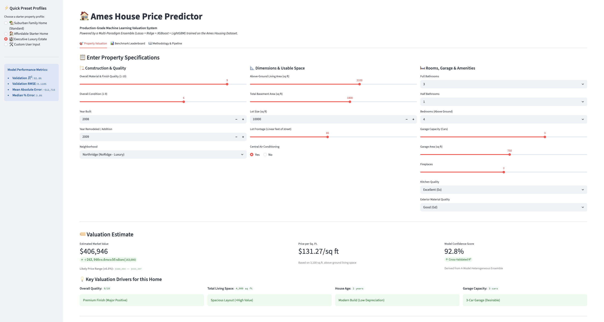
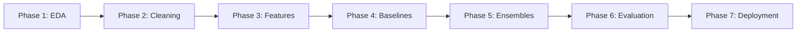

# 🏠 End-to-End House Price Predictor

[](https://www.python.org/)
[](https://scikit-learn.org/)
[](https://xgboost.readthedocs.io/)
[](https://lightgbm.readthedocs.io/)
[](https://streamlit.io/)
[](https://opensource.org/licenses/MIT)

> A production-ready real estate valuation system powered by a **Multi-Paradigm Ensemble** (Lasso + Ridge + XGBoost + LightGBM) trained on the **Ames Housing Dataset**. Features a modern, interactive Streamlit web dashboard for real-time market value estimation.

---

## 📌 Executive Summary & Key Results

- **Validation $R^2$ Score**: **`92.8%`** of home price variance explained across held-out test homes.
- **Validation RMSE (log)**: **`0.1105`** (top-tier competition accuracy).
- **Mean Absolute Error (MAE)**: **`~$12,715`** (predicting real estate market values within ~3.8% median error).
- **Architecture**: A heterogeneous blend uniting linear global regularization (Lasso & Ridge) with non-linear tree gradient boosting (XGBoost & LightGBM).
- **Interactive UI**: Real-time valuation web application deployed with Streamlit.

---

## 📸 Dashboard Preview

| Real-Time Property Valuation Dashboard |
|:---:|
|  |
| *Real-time valuation card showing predicted price, confidence intervals, price/sq ft, and key positive/negative value drivers.* |

| Benchmark Leaderboard |
|:---:|
|  |
| *Interactive side-by-side leaderboard ranking all 11 model configurations across cross-validation and test splits.* |

|Starter Presets & Inputs |
|:---:|
| |
| *1-click starter presets (Suburban Family Home, Starter Home, Luxury Estate) for instant valuation.* |

---

## 🏆 Model Benchmarking Leaderboard

We trained and evaluated **11 candidate architectures** across linear, regularized, tree, and ensemble paradigms using identical 5-fold cross-validation and holdout validation splits:

| Rank | Model Architecture | Paradigm | Val RMSE (log) | Val $R^2$ | Val MAE ($) | Description & Key Insights |
|:---:|---|:---:|:---:|:---:|:---:|---|
| 🥇 | **Weighted Blend (Lasso+Ridge+XGB+LGB)** | **Multi-Paradigm Ensemble** | **0.1105** | **92.8%** | **$12,715** | **Winning Model**. Blends complementary linear global signals with non-linear tree interactions, dropping MAE by ~$1,000. |
| 🥈 | **Lasso Regression ($\alpha=0.00049$)** | Linear Regularized (L1) | 0.1108 | 92.7% | $13,713$ | L1 sparsity penalty zeroed out 91 uninformative features automatically. |
| 🥉 | **Stacking Regressor (Ridge Meta)** | Multi-Paradigm Ensemble | 0.1115 | 92.6% | $12,845$ | 5-fold out-of-fold meta-learner combining linear and tree predictions. |
| 4 | **Ridge Regression ($\alpha=16.0$)** | Linear Regularized (L2) | 0.1157 | 92.1% | $13,824$ | L2 penalty prevented collinear coefficient explosion across 192 features. |
| 5 | **Tuned XGBoost** | Gradient Boosted Tree | 0.1168 | 91.9% | $13,709$ | Tuned via `RandomizedSearchCV` (`depth=4`, `subsample=0.6`, `reg_lambda=2.0`). |
| 6 | **Default XGBoost** | Gradient Boosted Tree | 0.1172 | 91.8% | $13,969$ | Strong out-of-the-box non-linear interactions. |
| 7 | **Gradient Boosting (GBM)** | Gradient Boosted Tree | 0.1206 | 91.4% | $14,288$ | Scikit-learn sequential boosting with learning rate shrinkage. |
| 8 | **LightGBM** | Histogram Boosted Tree | 0.1259 | 90.6% | $14,178$ | Fast leaf-wise histogram tree growth. |
| 9 | **Linear Regression (OLS)** | Linear OLS | 0.1304 | 0.8991 | $14,677$ | Unregularized baseline (slight overfitting due to multicollinearity). |
| 10 | **Random Forest** | Bagged Trees | 0.1402 | 88.3% | $15,760$ | Bagging 300 randomized trees reduces variance. |
| 11 | **Decision Tree (depth=6)** | Single Tree | 0.1929 | 77.9% | $23,376$ | Single tree baseline (step-function discretization error). |

---

## 🔍 Key Feature Engineering & Insights

1. **`TotalSF` ($r = +0.818$)**: Appraisers evaluate total combined usable floor space (`TotalBsmtSF` + `1stFlrSF` + `2ndFlrSF`). Outperformed every single individual square footage predictor.
2. **`TotalBath` ($r = +0.677$)**: Weighted bathroom calculation (`FullBath` + $0.5 \times$ `HalfBath` + `BsmtFullBath` + $0.5 \times$ `BsmtHalfBath`).
3. **`HouseAge` & `RemodAge` ($r = -0.588$ / $-0.569$)**: Property age at time of sale captures true physical depreciation far better than raw calendar years.
4. **Ordinal Mappings**: Transformed 19 quality ratings (`ExterQual`, `KitchenQual`, `BsmtQual`, etc.) into monotonic integer scales ($0$ to $5$), preventing the creation of 70+ sparse dummy columns.
5. **Log1p Skew Normalization**: Applied $\text{log}(1 + x)$ to 19 continuous features with $|\text{skew}| > 0.75$ (`LotArea` skew dropped from $12.57 \to -0.18$), mitigating extreme leverage points for linear models.
6. **Feature Importance Hierarchy**: Split gain analysis revealed that `OverallQual`, `TotalSF`, `HasFireplace`, `KitchenQual`, and `GarageCars` dominate tree splits.

---

## 🧱 Project Structure

```text
End-to-End House Price Predictor/
├── app/
│   └── streamlit_app.py            # Interactive real estate valuation dashboard
├── assets/
│   └── screenshots/                # Application UI screenshots for documentation
├── data/
│   ├── raw/                        # Immutable raw Ames data (train.csv, test.csv)
│   └── processed/                  # Cleaned & feature-engineered datasets (gitignored)
├── models/
│   └── best_model.pkl              # Production multi-paradigm ensemble artifact
├── notebooks/                      # Sequential phase-by-phase learning notebooks
│   ├── 01_phase1_eda.ipynb         # Exploratory Data Analysis & visual discovery
│   ├── 02_phase2_cleaning.ipynb    # Missing value imputation & outlier removal
│   ├── 03_phase3_features.ipynb    # Domain feature engineering & encoding
│   ├── 04_phase4_baseline.ipynb    # OLS, Ridge, Lasso, and Decision Tree benchmarks
│   ├── 05_phase5_advanced.ipynb    # XGBoost, LightGBM, tuning, and blending
│   └── 06_phase6_evaluation.ipynb  # Residual analysis, learning curves, and Kaggle inference
├── plots/                          # High-resolution phase-wise diagnostic charts
│   ├── phase1/                     # EDA charts (distributions, heatmaps, outliers)
│   ├── phase4/                     # Baseline diagnostics (residuals, top coefficients)
│   ├── phase5/                     # Ensemble comparisons & feature importance plots
│   └── phase6/                     # Q-Q normality, learning curves, tier breakdown
├── src/                            # Modular, reusable production Python modules
│   ├── __init__.py
│   ├── cleaning.py                 # Outlier removal, domain imputation, type casting
│   ├── features.py                 # Feature creation, ordinal mapping, column alignment
│   ├── models.py                   # BlendedRegressor, tuning, stacking architecture
│   └── evaluate.py                 # Metrics, cross-validation, plotting, serialization
├── .gitignore                      # Clean exclusion rules (CSVs, checkpoints, temp files)
└── README.md                       # Complete project documentation
```

---

## ⚡ Quickstart & Local Setup

### 1. Clone the Repository
```bash
git clone https://github.com/your-username/house-price-predictor.git
cd house-price-predictor
```

### 2. Install Dependencies
```bash
pip install numpy pandas scikit-learn xgboost lightgbm streamlit matplotlib seaborn scipy joblib
```

### 3. Launch the Interactive Web Dashboard
```bash
streamlit run app/streamlit_app.py
```
*The web app will automatically launch in your browser at `http://localhost:8501`.*

---

## 🔬 Methodology & Lifecycle



1. **Phase 1 — Exploratory Data Analysis**: Discovered target skew ($1.88$), isolated $2$ partial sale outliers (`GrLivArea > 4000` & `SalePrice < $200k`), and mapped correlation hierarchies.
2. **Phase 2 — Data Cleaning**: Domain-aware missing value imputation (distinguishing absence of amenity from missing data) and rare category consolidation.
3. **Phase 3 — Feature Engineering**: Built composite real estate features, mapped ordinal hierarchies, log-transformed skewed features, and aligned 192 dummy columns with zero nulls.
4. **Phase 4 — Baseline Modeling**: Established linear and regularized baselines (OLS, Ridge, Lasso, Decision Tree), proving L1/L2 shrinkage benefits.
5. **Phase 5 — Advanced Ensembles**: Trained Random Forest, GBM, XGBoost, and LightGBM; tuned hyperparameters with `RandomizedSearchCV`; and constructed the winning Weighted Blend Ensemble.
6. **Phase 6 — Diagnostics & Submission**: Validated residual normality via Q-Q plots, checked sample size learning curves, verified error consistency across market tiers, and exported Kaggle predictions.
7. **Phase 7 — Streamlit Web App**: Built an interactive UI with live valuation metrics, starter presets, confidence intervals, and benchmark dashboards.

---

## 📦 MLOps & Production Artifact Notes

- **Zero-Setup Deployment**: The trained model artifact (`models/best_model.pkl`, ~2.8 MB) is tracked in the repository to enable instant, zero-setup deployment on cloud platforms like **Streamlit Community Cloud** or **Render**.
- **Enterprise Consideration**: In large enterprise production environments with gigabyte-scale model binaries, models are typically hosted in external artifact registries (e.g., **MLflow Model Registry**, **AWS S3**, **Google Cloud Storage**, or **DVC**) rather than Git.

---

## 📄 License
This project is licensed under the MIT License — see the [LICENSE](LICENSE) file for details.
